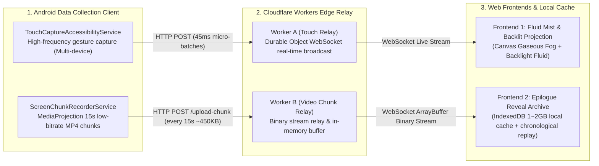

# Digital Wasteland — Interactive Privacy Exfiltration Installation

> **Artistic Concept**: Materializing the invisible exfiltration of personal digital privacy into a responsive, evolving landscape of gaseous mist and subsurface backlight illumination. Every tap and swipe on exhibition mobile devices is seamlessly captured and reflected as fluid eddies and illuminating backlights across public projections; in the exhibition's epilogue, hours of locally cached screen recordings play back in chronological order to deliver a dramatic psychological revelation.

---

## 1. System Architecture (Serverless & Zero Cloud Storage)



---

## 2. Directory Structure

- **[`frontend-wasteland/`](frontend-wasteland/index.html)**: Frontend 1 (Fullscreen Gaseous Mist & Subsurface Backlight Fluid Projection)
  - [`index.html`](frontend-wasteland/index.html): Fullscreen projection viewport with minimal click-to-start overlay
  - [`wasteland.js`](frontend-wasteland/wasteland.js): Particle and volumetric mist simulation engine with multi-device backlight assignment
  - [`soundscape.js`](frontend-wasteland/soundscape.js): Audio interface stub for dynamic acoustic integration
  - [`styles.css`](frontend-wasteland/styles.css): Minimal dark aesthetics
- **[`frontend-reveal/`](frontend-reveal/index.html)**: Frontend 2 (Epilogue Forensic Archive & Chronological Replay)
  - [`index.html`](frontend-reveal/index.html): Video player viewport with cache counter and one-click play trigger
  - [`reveal.js`](frontend-reveal/reveal.js): IndexedDB persistent cache store and chronological video queue controller
  - [`styles.css`](frontend-reveal/styles.css): Forensic archive visual theme
- **[`workers/`](workers/)**: Cloudflare Workers Edge Relay
  - [`worker-a-touch/`](workers/worker-a-touch/): Worker A touch stream broadcast relay
  - [`worker-b-video/`](workers/worker-b-video/): Worker B 15-second MP4 slice stream relay with memory ring buffer
- **[`android-client/`](android-client/)**: Native Android Client (Kotlin)
  - [`MainActivity.kt`](android-client/app/src/main/java/art/wasteland/client/MainActivity.kt): Minimal one-click launcher
  - [`TouchCaptureAccessibilityService.kt`](android-client/app/src/main/java/art/wasteland/client/TouchCaptureAccessibilityService.kt): Accessibility gesture streamer with automatic per-device identifier
  - [`ScreenChunkRecorderService.kt`](android-client/app/src/main/java/art/wasteland/client/ScreenChunkRecorderService.kt): `MediaProjection` 480x848 low-bitrate H.264 slice recorder
- **[`DigitalWasteland-Client.apk`](DigitalWasteland-Client.apk)**: Production signed APK ready for installation on Android devices.

---

## 3. Configuration & Endpoints

Server endpoints in the open-source release are intentionally left blank for standalone privacy and custom deployment:

1. **Frontend 1 (Fluid Mist & Backlight Main Projection)**:
   - Configure `WORKER_A_WS` in `frontend-wasteland/wasteland.js` (e.g. `wss://<your-worker-a-subdomain>.workers.dev/ws?role=consumer&room=main`)
2. **Frontend 2 (Epilogue Reveal System)**:
   - Configure `WORKER_B_WS` in `frontend-reveal/reveal.js` (e.g. `wss://<your-worker-b-subdomain>.workers.dev/ws?role=consumer&room=main`)
3. **Android Client**:
   - The Android client operates in privacy-safe local mode with zero server egress by default. Custom relay ingestion endpoints can be attached if server streaming is desired.

---

## 4. Exhibition Setup Guide

### Android Phone Setup (Install Single APK on Any Device)
1. Install [`DigitalWasteland-Client.apk`](DigitalWasteland-Client.apk) on one or more Android phones.
2. Open the app and tap **"START TELEMETRY"** (if prompted, enable *Digital Wasteland Telemetry* in Accessibility Settings).
3. Confirm the screen recording prompt. The application automatically minimizes and runs silently in the background.

### Gallery Projection Setup
1. On the projector display, open **Frontend 1** in full-screen (`F11` / `Cmd+Shift+F`) and click anywhere to start.
2. In the epilogue room (or at the end of the exhibition), open **Frontend 2** to replay all cached recordings in chronological sequence.

---

## 5. Development & Build Commands

### Deploy Cloudflare Workers
```bash
# Deploy Worker A (Touch Relay + Frontend 1)
npx wrangler deploy --config workers/worker-a-touch/wrangler.toml

# Deploy Worker B (Video Relay + Frontend 2)
npx wrangler deploy --config workers/worker-b-video/wrangler.toml
```

### Build Android APK
The project includes a pure Kotlin build pipeline using `kotlinc`, `aapt2`, `d8`, and `apksigner`.
```bash
# Compiles and produces signed DigitalWasteland-Client.apk in root
bash -c "export ANDROID_HOME=/path/to/android-sdk && ... (see build script)"
```
